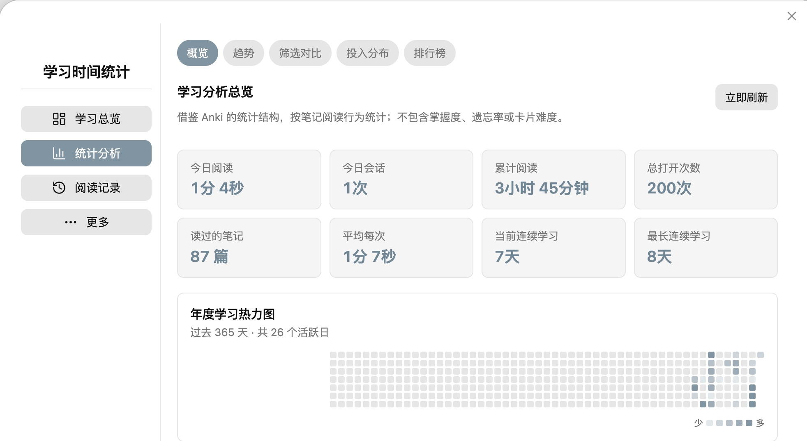
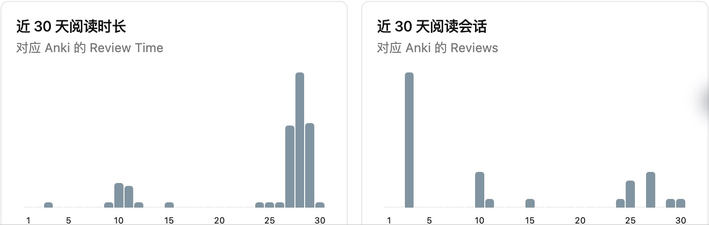

# Study Time Statistics

**English (this page)** · [完整中文说明](README_zh.md) · [中文摘要](#中文摘要)

Study Time Statistics helps you see where your reading time goes in Obsidian. It tracks time and opens for notes and PDFs, shows a small statistics strip inside each Markdown note, and turns your local history into trends, rankings, and a study-investment map. You can optionally record how much of a note you read. It never writes statistics into your Markdown content.

**This guide covers the 2.5.0 release.** Later features under development are not presented as available here; see the [release roadmap](ROADMAP.md).



*A direct crop of the actual Obsidian interface, captured on 2026-10-02 from a 3.0.0 development build. Its controls may differ from 2.5.0. No note titles, paths, folders, or contents are shown.*

## What it does

| In Obsidian | What you can see or do |
| --- | --- |
| At the top of a Markdown note | See opens, total and average time, longest session, active days, current streak, and last read time. The strip scrolls with the note and does not alter its file. |
| Study Overview | See today and this week, goal progress, previous-week comparison, session-quality indicators, high-investment hours, and notes you have not opened recently. |
| Analytics | Explore trends, heatmaps, five rankings, local filters and period comparisons, plus a folder-by-folder investment map. |
| Records | Inspect or correct sessions, optionally record reading coverage and position, and set daily or weekly goals. |
| More | Check data health and open feedback forms. Backup and restore commands are in the Command Palette. |

### Automatic tracking and per-note statistics

- Track time and opens while reading Markdown notes or PDFs. The status bar also shows the active file's accumulated time. The default Strict mode pauses the timer when Obsidian loses focus. In 2.5.0, you can also choose an idle timeout (20 minutes by default, or 0 to disable it); neither setting proves that you understood the material.
- The Markdown note strip is part of the editor/preview UI, not the document. It scrolls out of view with the content and shows seven core metrics; when optional coverage is enabled, it can also show coverage, position, and characters read.
- Open count and reading sessions are kept separately. You can inspect session start, duration, and note later, and add, edit, or delete a session if the automatic record was inaccurate.

### Analytics, comparisons, and navigation

- See day, week, month, year, and all-time views; a 365-day reading-time heatmap; 30-day time and session charts; 24-hour, weekday, and session-length distributions; folder summaries; and recent sessions. Charts follow the Obsidian accent color by default, with an optional custom color. Heatmap shades indicate intensity; bar height or length indicates value elsewhere.
- Compare notes by most opens, longest total time, longest average visit, longest single session, or most active days. Rankings are **within your own vault**, not against other users.
- Filter sessions by date range, folder, or note name, compare the selected period with the preceding period of the same length, and open a source note from the results.
- Browse the investment map by time, opens, coverage, or recency. It includes unread Markdown/PDF files, supports folder drill-down, and shows frequent transitions between non-overlapping sessions at most 30 minutes apart. It does not infer a topic or learning outcome from those paths.

### Optional reading records and goals

- Turn on **Reading Coverage** to record a self-reported percentage for each visit. You may also enter start/end position and characters read; if characters are left blank, the plugin labels its character estimate as estimated. Coverage history, note and folder summaries, a 365-day coverage heatmap, hourly patterns, repeated-reading totals, equivalent passes, and time per 1,000 characters are available from the Records area.
- Set local daily and weekly time goals, inspect a 28-day progress trend, and review unusually long or ambiguous sessions. Local interaction signals can label a session interactive, quiet study, needs review, or unclassified. A label is a prompt for review, not proof of attention; the plugin never silently deletes an ambiguous session.

### Control over your data

- Data stays in your vault. There is no plugin account, telemetry, advertising, or automatic network upload. The dashboard's Feedback page opens GitHub forms only when you choose to use them.
- The dashboard and its filters, maps, and tables adapt to narrower screens. Touch and page-visibility events also help the timer respond on mobile and in multi-window use.
- Use the Command Palette to create a timestamped local backup or restore the latest usable backup. Under More, Data Health checks duplicate or invalid sessions and references to missing notes. Safe repairs make a backup first; missing-note history is retained instead of erased. Renaming a note moves its associated records to the new path. The 20 newest backups are retained automatically.

## Reading the numbers correctly

- **Open** means the plugin observed a note becoming active. **Average time per visit** is that note's tracked time divided by its open count; it is not the average of completed-session lengths.
- **Tracked time** reflects time recorded while the note is active, subject to the focus setting and timing limits. Quiet study and leaving a window open can look similar; review or correct doubtful sessions rather than treating the timer as a measure of attention.
- **Reading coverage** is the sum of your self-reported visit percentages, capped at 100% per note. It is not a test of comprehension, memory, or mastery. Unique-character reach and reading pace are estimates based on those entries and character counts, not direct measures of information absorbed.
- **Revisit suggestions** mean only that a note has not been opened recently. They do not predict forgetting.

## Real, anonymized snapshot

The captured development build shows **87 notes read**, **200 opens**, and **3h 45m** of recorded reading time as of 2026-10-02. These are the owner's real, point-in-time aggregate values, shared with permission—not sample data, a benchmark, or a live counter. The screenshot excludes note-level rankings and all private titles, paths, folders, and contents.



*The two 30-day charts are another direct crop of the same interface capture. We show aggregate views here to keep private note details out of public screenshots.*

## Open the dashboard

Select the bar-chart icon in the left ribbon, or open the Command Palette and run **Open Study Time Statistics**. Start with **Study Overview**, then use **Analytics**, **Records**, or **More** as needed. Reading Coverage is off by default; enable it from its page or the plugin settings.

## Installation

### Community Plugins

Study Time Statistics is available in the Obsidian Community Plugins directory. Open **Settings → Community plugins → Browse**, search for **Study Time Statistics**, and select **Install**.

[View Study Time Statistics in the Obsidian plugin directory](https://obsidian.md/plugins?id=study-time-statistics)

### Manual installation

1. Download `main.js`, `manifest.json`, and `styles.css` from the latest GitHub release.
2. Create `<vault>/.obsidian/plugins/study-time-statistics/`.
3. Copy the three files into that directory.
4. Restart Obsidian, then enable **Study Time Statistics** under **Settings → Community plugins**.

## Privacy and storage

Primary statistics are stored in `.obsidian/plugins/study-time-statistics/data.json` inside your vault. The plugin stores note paths and local study metrics needed for its charts. When Reading Coverage is enabled, it also stores self-reported percentages, note character-count snapshots, related active durations, and local interaction counts and timestamps. It never stores note contents. Timestamped backups are saved separately to `Study Time Statistics Backups/` in the vault and therefore contain the same private note paths and metrics. It does not automatically send data over the network. The public screenshots contain a permissioned, point-in-time snapshot of real aggregate values, but no note title, path, folder, or content field is visible.

### Syncing between devices

The plugin does not implement or require a separate cloud service. If your whole vault—including its `.obsidian` configuration folder—is synchronized by Obsidian Sync, iCloud Drive, Nutstore, or another file-sync provider, the plugin data can travel with that vault according to the provider's settings. Enable configuration-folder syncing on every device and avoid editing the same data concurrently while a provider is still resolving conflicts. Backups in `Study Time Statistics Backups/` may also be synchronized because they are normal vault files.

## Feedback and support

The dashboard includes a **Feedback** page that opens the appropriate GitHub form for bugs, inaccurate statistics, feature requests, or discussions. The plugin never submits study data automatically; nothing is sent until the user explicitly submits a GitHub form.

- [Report a bug](https://github.com/tanzy226/obsidian-study-time-statistics/issues/new?template=bug_report.yml)
- [Report inaccurate statistics](https://github.com/tanzy226/obsidian-study-time-statistics/issues/new?template=data_accuracy.yml)
- [Suggest a feature](https://github.com/tanzy226/obsidian-study-time-statistics/issues/new?template=feature_request.yml)
- [Ask a question or share an idea](https://github.com/tanzy226/obsidian-study-time-statistics/discussions)

Before posting screenshots or logs, replace private note titles and paths with anonymous examples.

## Development

```bash
npm install
npm test
npm run build
```

The production build generates `main.js`. A GitHub release must include `main.js`, `manifest.json`, and `styles.css`, with a tag matching the version in `manifest.json` exactly.

## Compatibility

- Obsidian 1.13.0 or later
- Desktop and mobile manifests are supported; background-focus behavior depends on the operating system

## Credits and license

Study Time Statistics is an independent plugin inspired by Anki's statistical presentation. It is not affiliated with or endorsed by Anki.

The codebase is derived from [AstraDev's open-source Obsidian time tracker](https://github.com/astradev123/obsidian-focus-time), used under the Apache License 2.0. Original copyright notices and license terms are preserved. See [LICENSE](LICENSE) and [NOTICE](NOTICE).

---

## 中文摘要

Study Time Statistics（学习时间统计）是一款本地隐私优先的 Obsidian 插件，统计笔记与 PDF 的阅读时间和打开次数，在 Markdown 笔记顶部展示随正文滚动的统计条，并提供学习总览、趋势与热力图、五类本地排行榜、筛选对比和按文件夹浏览的投入地图。它不会改写笔记原文。

本页按 2.5.0 版介绍。可选的阅读覆盖度、位置与字符统计只描述阅读行为，不代表吸收、理解或记忆。完整功能、数据口径和使用方法见 [中文说明](README_zh.md)。

上方图片是 2026-10-02 从实际 Obsidian 界面直接裁切的截图，显示当时 **87 篇已读笔记、200 次打开、累计 3 小时 45 分钟**。截图来自当时尚未公开发布的 3.0.0 开发版；截取时公开最新版为 2.2.0，部分控件可能不同。公开图片仅展示汇总数据，没有笔记标题、路径、文件夹或正文。

所有学习数据仅保存在本地库中，插件不上传数据、不收集遥测、无广告，也不需要云端账户。若整库同步包含 `.obsidian` 配置文件夹，数据可随 Obsidian Sync、iCloud、坚果云等现有方案同步，无需插件另建同步服务。完整中文说明见 [README_zh.md](README_zh.md)。
