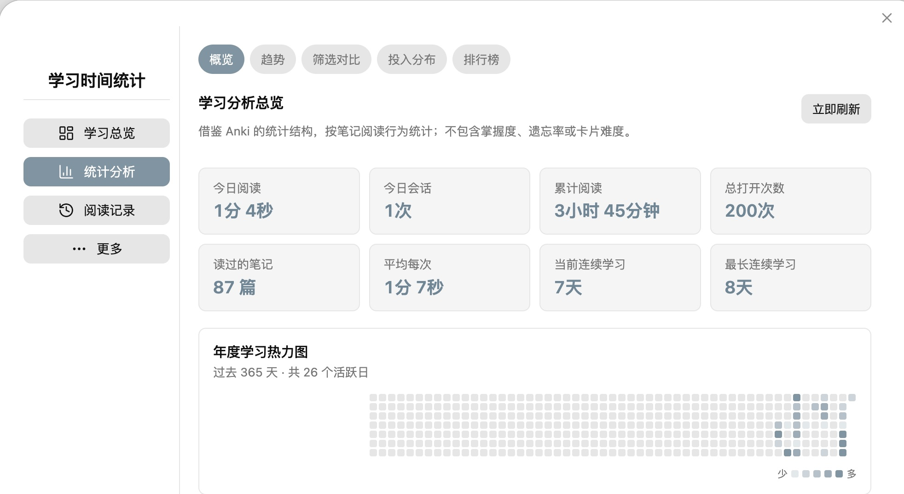
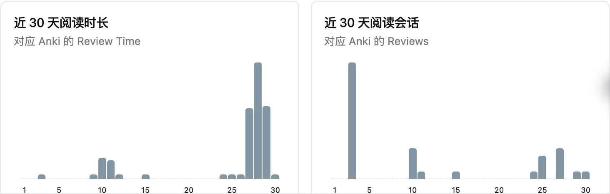

# Study Time Statistics（学习时间统计）

[English](README.md)

在 Obsidian 里看看时间花在了哪里。Study Time Statistics 会记录笔记和 PDF 的阅读时长与打开次数，并用趋势、热力图和**你自己库内的排行**展示这些记录。Markdown 笔记的统计条可放在顶部、底部或隐藏，不改写笔记正文。

数据留在你的库里，不需要额外账号，也不会自动上传。你可以复核阅读会话、设置目标，或选择记录每次读了多少。

[安装](#安装) · [打开仪表盘](#打开仪表盘) · [3.0.1 更新说明](.github/release-notes/3.0.1.md) · [版本路线](ROADMAP.md)



*2026-10-02 从 Obsidian 中运行的 3.0.0 开发版直接裁切。这不是概念图；截图只显示汇总统计，没有笔记标题、路径、文件夹或正文。*

## 能做什么

| 在 Obsidian 的位置 | 可以查看或操作的内容 |
| --- | --- |
| Markdown 笔记内 | 可选默认的简洁单行、完整统计或隐藏，并可放在顶部或底部。统计条随正文滚动，不修改文件。 |
| 学习总览 | 今日与本周投入、目标进度、周环比、会话质量、高投入时段和最近未打开的笔记。 |
| 统计分析 | 趋势与热力图、五类排行榜、本地筛选及周期对比、按文件夹浏览的投入地图。 |
| 阅读记录 | 检查和修正会话；可选记录阅读覆盖度、位置与字符；设置日、周目标。 |
| 更多 | 导出本地报告、检查数据健康、合并兼容的快照或提交反馈。创建和恢复备份的命令在命令面板中。 |

### 自动计时与单篇统计

- 阅读 Markdown 笔记或 PDF 时记录时间和打开次数；状态栏也会显示当前文件的累计阅读时间。默认启用的“严格模式”会在 Obsidian 失去焦点时暂停计时。空闲暂停时间默认为 20 分钟，可调整或设为 0 关闭。
- Markdown 笔记中的统计条属于编辑/预览界面，不属于笔记原文。默认单行显示打开次数与累计时间；完整模式显示七项核心指标和可选的阅读覆盖信息。可在插件设置中选择顶部、底部或隐藏，滚动时会随正文离开视野。
- 打开次数和有计时的会话不是同一个指标。你可以复核会话的开始时间、时长和对应笔记，在不误改其他统计的前提下补记或修正。

### 趋势、对比与投入地图

- 按日、周、月、年或全部时间看统计；查看过去 365 天的阅读时长热力图、近 30 天时长与会话图、24 小时与星期分布、单次时长分布、文件夹汇总和最近会话。图表默认跟随 Obsidian 主题色，也可自选颜色；只有热力图用深浅表示强弱，其他图表由柱高或条长表示大小。
- 五类排行榜分别按打开次数、累计阅读、平均每次、最长单次和活跃天数排序。它们只比较**你自己库内的笔记**，不是与其他用户竞争。
- “分析筛选”可按日期、文件夹和笔记名称筛选会话，与等长的上一周期比较，并从结果打开原笔记。
- “学习投入分布”可按时长、打开次数、阅读覆盖或最近阅读浏览整个库，未读的 Markdown/PDF 也在其中；点进文件夹可逐层查看。连续阅读关系只统计两个不重叠、相隔不超过 30 分钟的会话，不推断笔记主题或学习成果。

### 可选的阅读记录与目标

- 开启“阅读覆盖度”后，可给每次阅读填写一个百分比，也可填写阅读起止位置和实际阅读字符；字符数留空时会明确标记估算值。你可以查看记录历史、单篇与文件夹覆盖汇总、365 天覆盖热力图、时段分布、重复阅读量、等效通读遍数和每千字用时。
- 可设置完全本地的日目标与周目标，查看 28 天达标趋势，并人工复核异常长或有歧义的会话。本地交互信号会把新会话标记为“持续交互”“静默学习”“需确认”或“未分类”；标签只是复核线索，不是注意力证明，插件不会悄悄删除有歧义的记录。

### 数据与外观控制

- 数据只存在你的库中：不需要插件账号，没有遥测、广告或自动上传。仪表盘的“反馈与建议”只会在你主动选择时打开 GitHub 表单。
- 在“更多 → 报告导出”中选择日期范围，即可预览本地汇总，并下载 JSON、CSV、Markdown 或复制 Markdown 报告。默认隐藏笔记名称；只有确实需要在导出文件中保留真实路径时才关闭此选项。即使隐藏名称，导出文件仍可能包含私人学习时段与时长。
- 仪表盘及筛选、地图、表格在较窄的屏幕上会调整布局；触摸与页面可见性信号也帮助计时器适应移动端及多窗口使用。
- 可通过命令面板创建带时间戳的本地备份或恢复备份。“更多 → 数据管理”会检查重复或无效会话和失效的笔记引用；暂时找不到笔记时保留历史。自动清理只针对识别为本插件生成的备份，不碰同目录下的其他文件。
- 在“更多 → 数据管理”里可以合并兼容的快照，写入前会先备份。3.0.1 在不能安全核对统计时会拒绝合并或修正。例如，旧会话可能只保存了总时长，没有每段有效计时的时间，插件不会猜测该修改哪一天的记录。若合并被拒绝，请保留两份快照。

## 怎样理解这些数字

- **打开次数**：插件观察到笔记成为当前笔记的次数。**平均每次**＝该笔记累计计时时长 ÷ 打开次数，不是“已完成会话时长的平均数”。
- **阅读时长**：笔记处于活动状态时记录的时间，受窗口焦点设置和计时上限影响。静默学习和放着不动可能看起来相似；遇到可疑会话，可以人工复核或修正，别把计时器当成注意力检测器。
- **阅读覆盖度**：把你自行填报的各次百分比相加，单篇最多显示 100%。反复阅读同一段也会增加这个值，因此它不是去重覆盖率。字符数和阅读节奏也包含估算，不代表理解、记忆或掌握程度。
- **建议回看**：只表示某篇笔记最近没有打开，不预测你是否遗忘。

## 真实匿名化快照

截至 2026-10-02，截图中的本地统计为 **87 篇已读笔记、200 次打开、累计阅读 3 小时 45 分钟**。这些数字得到数据所有者许可，是真实的某一时点汇总值，不是样例数据、性能基准或实时计数器。截图排除了单篇排行榜和所有私人笔记标题、路径、文件夹、正文。



*这两张近 30 天图表也是同一次界面的直接裁切。公开截图只展示汇总视图，避免带出单篇笔记信息。*

## 打开仪表盘

点击左侧边栏的柱状图图标，或者打开命令面板并运行 **打开学习时间统计**。仪表盘分为“学习总览、统计分析、阅读记录、更多”四个主入口：排行榜与筛选分析归入“统计分析”，会话、阅读覆盖度和目标归入“阅读记录”，报告、数据管理和反馈归入“更多”。“阅读覆盖度”默认关闭，可在该页面或插件设置中开启。

## 安装

### 社区插件市场

插件已收录到 Obsidian 社区插件目录。打开 **设置 → 第三方插件 → 浏览**，搜索 **Study Time Statistics** 即可安装。

[在 Obsidian 插件目录中查看 Study Time Statistics](https://obsidian.md/plugins?id=study-time-statistics)

### 手动安装

1. 从 [GitHub 最新版本](https://github.com/tanzy226/obsidian-study-time-statistics/releases/latest)下载 `main.js`、`manifest.json` 和 `styles.css`。
2. 新建 `<你的库>/.obsidian/plugins/study-time-statistics/`。
3. 将三个文件复制到该目录。已有安装时只替换这三个文件，保留原有的 `data.json`。
4. 重启 Obsidian，然后在 **设置 → 第三方插件** 中启用 **Study Time Statistics**。

## 隐私与数据位置

主要统计保存在你自己的库内，具体为 `.obsidian/plugins/study-time-statistics/data.json`。插件会存储绘图所需的笔记路径与本地学习指标。开启阅读覆盖度后，还会保存你填写的百分比、可选起止位置、手填或估算的阅读字符数、当时的笔记字符数、对应有效时长，以及本地交互次数和时间戳，但绝不保存笔记正文。带时间戳的备份另外保存在库内的 `Study Time Statistics Backups/`，因此备份也包含相同的私人笔记路径和统计数据。插件不会自动通过网络发送数据。本仓库的公开图片使用经许可的真实汇总数值快照，但没有出现真实笔记标题、路径、文件夹或正文。

### 多设备同步

插件不另建云服务，也不要求单独登录账号。只要 Obsidian Sync、iCloud 云盘、坚果云或其他文件同步方案同步了整个库，并包含 `.obsidian` 配置文件夹，插件数据就会按照该服务的设置随库同步。请在各设备启用配置文件夹同步，并尽量避免在同步冲突尚未解决时由多台设备同时修改统计数据。`Study Time Statistics Backups/` 是普通库文件，也可能随整库同步。

## 反馈与支持

仪表盘内置“反馈与建议”页面，可分别打开错误报告、统计不准确、功能建议或讨论页面。插件不会自动提交学习数据；只有用户在 GitHub 表单中主动确认提交的内容才会发送。

- [报告错误](https://github.com/tanzy226/obsidian-study-time-statistics/issues/new?template=bug_report.yml)
- [报告统计不准确](https://github.com/tanzy226/obsidian-study-time-statistics/issues/new?template=data_accuracy.yml)
- [提交功能建议](https://github.com/tanzy226/obsidian-study-time-statistics/issues/new?template=feature_request.yml)
- [提问或讨论想法](https://github.com/tanzy226/obsidian-study-time-statistics/discussions)

提交截图或日志前，请用匿名示例替换私人笔记标题和路径。

## 开发与测试

```bash
npm install
npm test
npm run build
```

生产构建会生成 `main.js`。GitHub Release 必须附带 `main.js`、`manifest.json` 和 `styles.css`，并且标签必须与 `manifest.json` 中的版本号完全一致。

## 兼容性

- Obsidian 1.13.0 或更高版本
- 清单支持桌面端与移动端；后台焦点行为会因操作系统而异

## 致谢与许可证

Study Time Statistics 是一款独立插件，其统计展示受到 Anki 启发，但与 Anki 官方没有隶属或合作关系。

本项目基于 [AstraDev 的开源 Obsidian 计时项目](https://github.com/astradev123/obsidian-focus-time)继续开发，并遵守 Apache License 2.0。原始版权声明与许可证条款均予保留，详见 [LICENSE](LICENSE) 和 [NOTICE](NOTICE)。
